

  

  <a href="https://youtu.be/fibIiCN5sKY"><strong>▶ Watch GitJokBo in 15 seconds — sound on</strong></a> 
  Earlier promotional footage. The interface may change before release.

<h1 align="center">GitJokBo</h1>

  <strong>Your code has history. Make it easier to follow.</strong> 
  A free, native Git client for Windows, with a living view of your repository's history.

  <strong>Jokbo</strong> is Korean for <strong>family genealogy</strong>. 
  For everyone who has ever asked, “Which branch was that on?”

  Windows x64 &nbsp; · &nbsp;
  Free for personal &amp; commercial use &nbsp; · &nbsp;
  No GitJokBo account required

  <a href="https://github.com/YiMunDong/GitJokBo-Release/releases"><strong>Releases</strong></a>
  &nbsp; · &nbsp;
  <a href="#screenshots">Explore the screenshots</a>
  &nbsp; · &nbsp;
  <a href="#choose-your-atmosphere">Compare themes</a>
  &nbsp; · &nbsp;
  <a href="#get-started">Get started</a>
  &nbsp; · &nbsp;
  <a href="License.md">License</a>

---

**Coming soon.** The first public build has not been published yet. Downloads and release notes will appear on the [Releases page](https://github.com/YiMunDong/GitJokBo-Release/releases). The features below introduce the app currently in development.

## There was a reason for that branch. Probably.

The feature is on one branch. The fix is on another. The commit called `final fix` has three successors.

GitJokBo helps you follow the story with an animated lineage view built around your repository's actual commit relationships. See where work branches off, where it comes together, and what changed along the way.

Review a diff, stage your changes, and make the next commit in the same workspace. GitJokBo runs the Git for Windows you already use, with your existing Git credential helper and SSH configuration.

<a href="assets/screenshots/themes/cyber-joseon-dark.png">
  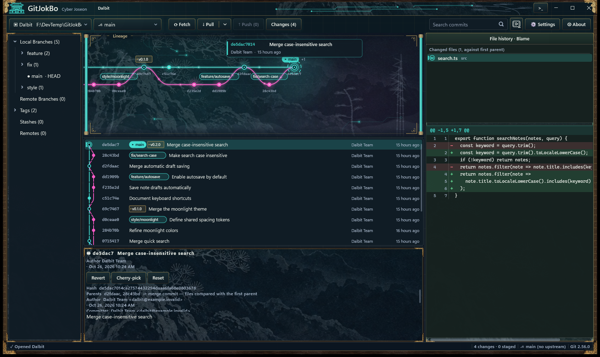
</a>

Branches, commits, and the change behind each one. Click any screenshot to see it at full size.

## Why GitJokBo?

| What you want to do | How GitJokBo helps |
| --- | --- |
| **See how the work connects** | Explore an animated lineage view alongside the commit list. Follow real parent relationships through branches and merges. |
| **Review before you commit** | Inspect file changes and diffs, stage files or individual hunks, and write your commit message in one workspace. |
| **Turn mixed changes into focused commits** | Use the visual commit composer to arrange file and hunk cards into an ordered set of commits, then review the plan before running it. |
| **Keep everyday Git work close** | Create and switch branches, merge, stash changes, and fetch, pull, or push to your remotes. |
| **Trace a change to its source** | Browse file history and line blame, or select a commit for revert or cherry-pick. |
| **Work through conflicts** | Review conflicting changes, mark resolutions, and use an external merge tool when you need one. |
| **Look back without checking out** | Explore Galaxy Time Machine, inspect files at a selected commit, and compare points in history. |
| **See your history from another angle** | Open Kim Cine and watch recent commits unfold as paper, ink, a helix, or a galaxy. |
| **Make the workspace your own** | Choose among four theme families and select your interface language. |

### Everyday Git, with the context still in view

- **Start where you are.** Open an existing repository, clone a remote, or initialize a new one.
- **Keep branches moving.** Create and switch branches, manage tags and remotes, and fetch, pull, push, or merge.
- **Put unfinished work aside.** Stash changes and return to them later.
- **Choose the right correction.** Amend a commit, revert a change, cherry-pick a commit, or review a soft, mixed, or hard reset.
- **See what Git said.** Open Output for command results. The Bash tab runs Git Bash commands from the repository; it is a command runner, not an interactive terminal session.

## Screenshots

These are **actual GitJokBo app captures with the interface set to English**, taken on October 27, 2026. They use **Dalbit**, a fictional notes project with a real local Git history prepared for this showcase. Names, commits, branches, and source snippets are demonstration data.

The screenshots show a development build, not a published release. Features and appearance may change before the first public build. [Capture notes](assets/screenshots/README.md).

### Review the change, then decide what belongs in the commit

Open **Changes** to see unstaged and staged files beside the diff. Stage a complete file or an individual hunk, write a message, and commit from the same view.

In this example, a search feature grows from matching titles to matching both titles and note bodies. The diff makes that decision visible before it becomes history.

<a href="assets/screenshots/changes.png">
  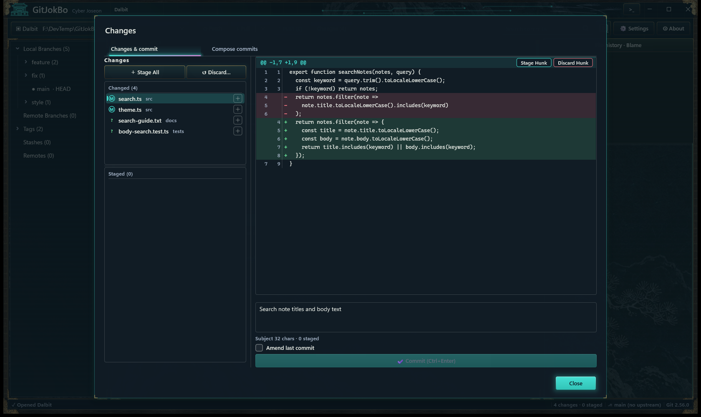
</a>

A feature change, a theme adjustment, and a guide update can share a working tree without sharing a commit.

### “Fix stuff” deserves a second draft

You fixed the bug, cleaned up a function, and corrected the README while you were there. Now one working tree contains three perfectly reasonable commits.

The **visual commit composer** gives each change a place before you create the history:

1. **Choose the changes.** Review file and hunk cards from your working tree.
2. **Build the sequence.** Assign cards to commit slots and give each commit its own message.
3. **Review and run.** Check the planned commits, then create them in order. Leave unrelated changes for later.

Give the next person reading your history a fighting chance. There is a good chance it will be you.

<a href="assets/screenshots/composer.png">
  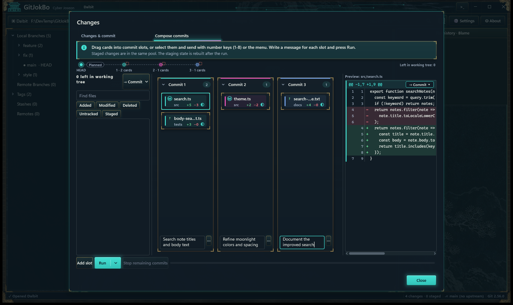
</a>

One working tree. Three focused commits. The planned history is visible before you run it.

Use up to **eight commit slots**. Move file or hunk cards by dragging, the send menu, or number keys. Each slot has its own message; the preview shows the selected card's changes. The confirmation step lists the plan before any commits are created.

### Find the change behind the line

File history follows a file through its commits, including renames. **Blame** connects individual lines to their authors and commits. Select a line, inspect its source, and open the corresponding commit in the main history view.

<a href="assets/screenshots/file-history.png">
  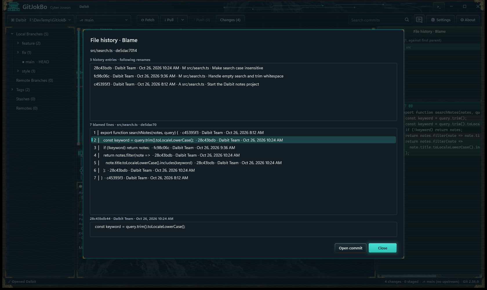
</a>

“Why is this here?” is easier to answer when the line comes with its history.

### Read the repository as it was

**Galaxy Time Machine** turns commits into points you can explore. Within the history reachable from HEAD when you enter, jump to a SHA, tag, branch, or date, and inspect the files and code at that point without checking out another revision.

Compare two points or branches, or choose a merge commit's parent for comparison. The close-up lineage shows actual parent links alongside the larger visual scene.

<a href="assets/screenshots/time-machine.png">
  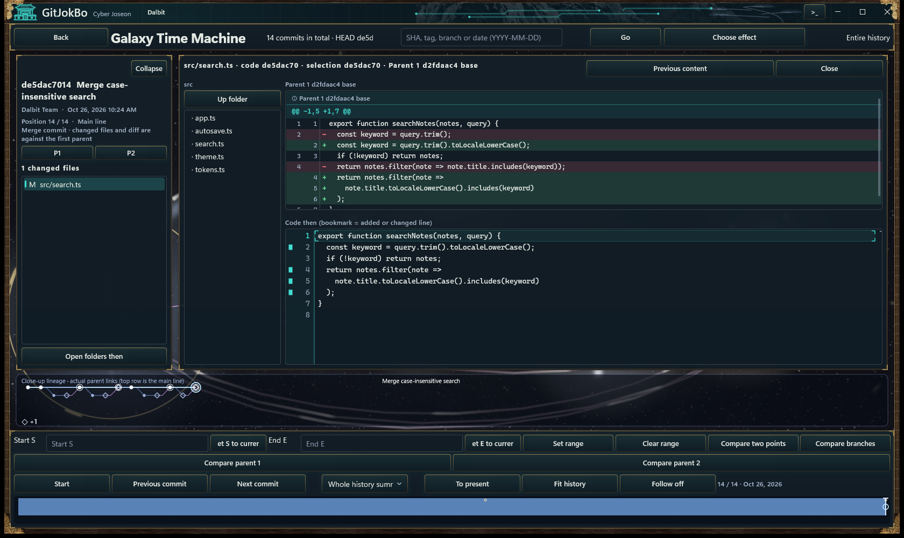
</a>

The selected commit, the comparison base, and the code from that moment stay together.

### Your history has a screening room

**Kim Cine** offers four scenes for watching recent commit history: **Paper lineage**, **Ink landscape**, **Lineage helix**, and **Galactic arms**. Pause, replay, or choose another effect to see the same repository in a different setting.

<a href="assets/screenshots/cinematic.png">
  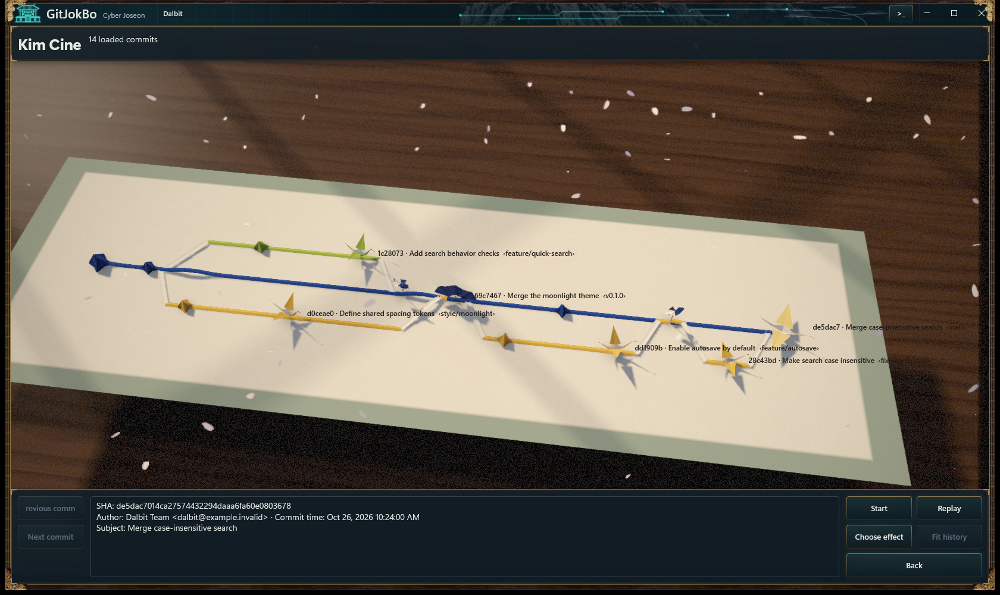
</a>

Even a small search fix can have an entrance.

The scenes are visual presentations of loaded history. Use the main lineage view or Galaxy Time Machine's parent links when investigating exact commit relationships.

## Choose your atmosphere

### A little Joseon. A little science fiction.

**Cyber Joseon** gives GitJokBo its own visual identity, combining Korean traditional motifs with illuminated paths and animated details that respond to repository state.

Your repository is allowed to have better lighting than your office.

The same Dalbit repository appears in every theme capture below. The interface remains in English throughout.

### Cyber Joseon

Ink landscapes, traditional ornament, and illuminated paths. A workspace with a sense of place.

| Dark | Light |
| :---: | :---: |
|  | [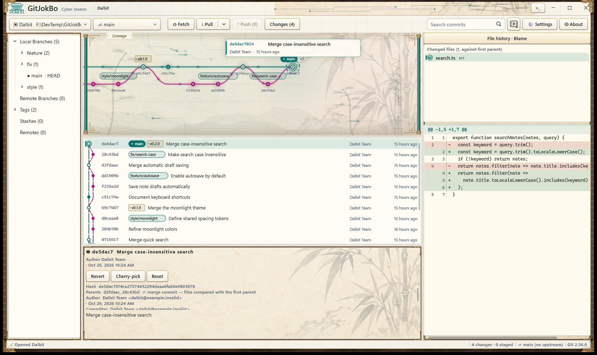](assets/screenshots/themes/cyber-joseon-light.png) |

### Soft Glass

Soft edges and a quieter palette for the days when the code brings enough drama.

| Dark | Light |
| :---: | :---: |
| [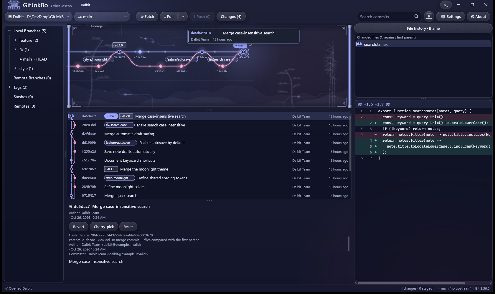](assets/screenshots/themes/soft-glass-dark.png) | [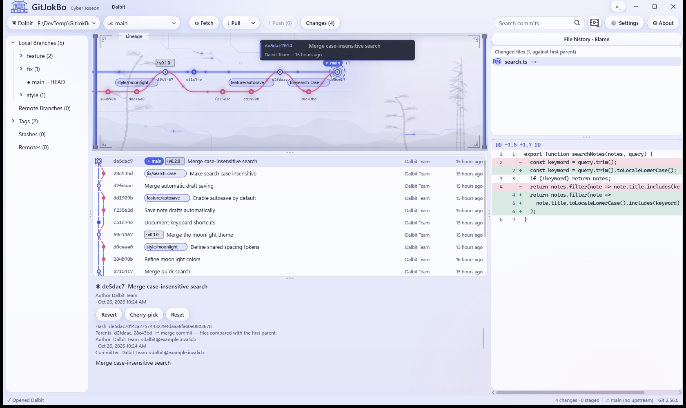](assets/screenshots/themes/soft-glass-light.png) |

### Jelly Pop and Hyper80s

Glossy color or a retro arcade mood. Your branch names can remain perfectly serious.

| Jelly Pop | Hyper80s |
| :---: | :---: |
| [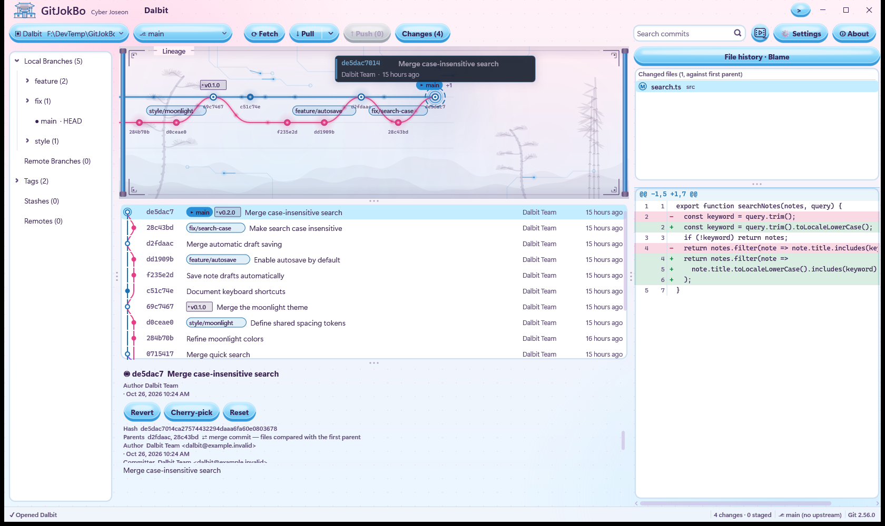](assets/screenshots/themes/jelly-pop.png) | [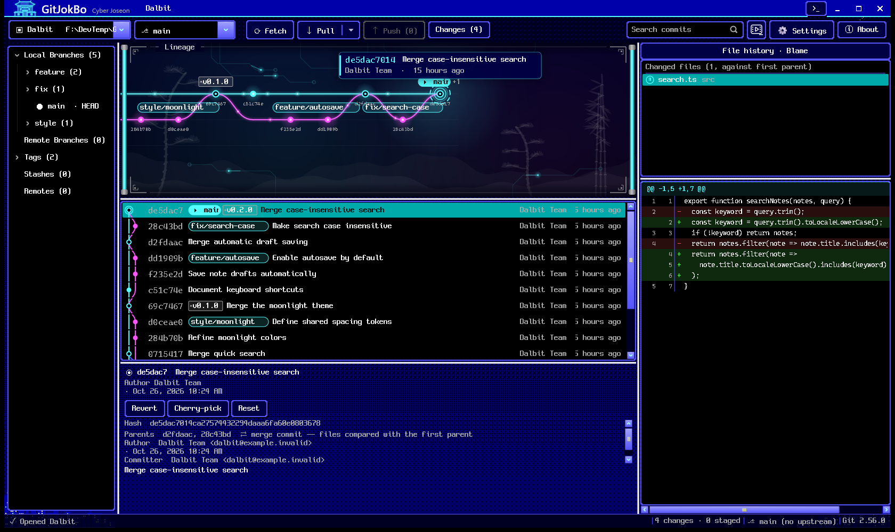](assets/screenshots/themes/hyper80s.png) |

Settings offers theme and brightness choices, while the app responds to Windows high contrast and reduced-motion preferences. You can also adjust visual frame-rate limits and effect intensity.

## Get started

### Requirements

| Component | Requirement |
| --- | --- |
| Operating system | Windows 10 version 1903 or later, x64. Windows 11 recommended. |
| Git | [Git for Windows](https://gitforwindows.org/) 2.35 or later, installed separately. |
| Runtime | [Microsoft Visual C++ Redistributable](https://learn.microsoft.com/cpp/windows/latest-supported-vc-redist), x64, v14. |

### When the first build is available

1. Open the [Releases page](https://github.com/YiMunDong/GitJokBo-Release/releases), read the release notes, and download the packaged ZIP from **Assets**.
2. Extract the complete archive to a folder of your choice.
3. Keep the `Languages` folder and the included license and notice files with `GitJokBo.exe`.
4. Run `GitJokBo.exe`, choose your language and appearance, and open a Git repository. If Git is not detected, set the path to `git.exe` in Settings.

There is no installer. Git and the Visual C++ runtime are separate prerequisites. GitHub's automatically generated **Source code** archives contain this release repository, not the application.

### Your first few minutes

1. **Open a repository.** Choose a local project, clone a remote, or initialize a new repository.
2. **Follow one commit.** Select a row in the commit list, find it on the lineage stage, and inspect its files and diff.
3. **Review your working tree.** Open **Changes**, choose the files or hunks to stage, and write your commit message.
4. **Split when it helps.** If the working tree contains unrelated changes, switch to **Compose commits** and give each change a place.
5. **Sync when ready.** Fetch to inspect remote updates, then pull or push as appropriate for your repository.

## Your tools. Your language. Your data.

- **Four interface languages:** English, Korean, Japanese, and Simplified Chinese.
- **An extra touch of character:** an optional traditional-style Korean language pack, alongside standard Korean.
- **Custom language packs:** create a translation from the included `en.properties` file and follow `Languages/README.txt` in the application package.
- **Local settings:** preferences and custom language packs live in `%APPDATA%\GitJokBo`. Logs, caches, and backup patches use `%LOCALAPPDATA%\GitJokBo`.
- **No GitJokBo account or telemetry:** remote Git operations use your configured repositories and authentication.

## Questions before you try it?

<strong>Is GitJokBo free for commercial work?</strong>

Yes. Personal, educational, corporate, commercial, and governmental use is free under the [license agreement](License.md). GitJokBo is proprietary freeware; its source code is not distributed.

<strong>Does GitJokBo include Git?</strong>

Git must be installed separately. GitJokBo uses your installed Git for Windows and its credential helper and SSH settings. You can choose a specific `git.exe` in Settings.

<strong>Is it a GitHub-only client?</strong>

No. GitJokBo works with local Git repositories and their configured remotes. Remote access uses Git for Windows and your existing authentication setup. GitHub hosts this distribution page; a GitJokBo account is not required.

<strong>Where is the download?</strong>

The first public build has not been published yet. When it is ready, the packaged ZIP and release notes will appear under [Releases](https://github.com/YiMunDong/GitJokBo-Release/releases). The screenshots show work in development and are not a release announcement.

<strong>Git is not detected. What should I check?</strong>

Install Git for Windows 2.35 or later. In GitJokBo Settings, use auto-detection or select your `git.exe` explicitly. If the application itself does not start because a Visual C++ runtime DLL is missing, install the Microsoft Visual C++ x64 Redistributable listed above.

<strong>Does the visual layout change my Git history?</strong>

Browsing the lineage, watching a Kim Cine scene, or reading historical code does not rewrite commits. Commit, merge, revert, cherry-pick, reset, and similar actions are explicit Git operations. Visual placement is a presentation; commit IDs and parent links remain the source of truth.

<strong>Can I share it with someone else?</strong>

You may share a complete, unmodified copy free of charge under the conditions in [section 4 of the license](License.md#4-free-sharing). Sharing the Releases link is an easy way to help others find the available builds.

<strong>How do I remove it?</strong>

Close GitJokBo and delete the extracted application folder. Settings and other local data remain in the folders listed above. Remove those separately if you no longer need them, including any backup patches.

## Help shape GitJokBo

Found something odd? Have a workflow that could use fewer clicks? [Open an issue](https://github.com/YiMunDong/GitJokBo-Release/issues).

For bug reports, include your GitJokBo version, Windows version, Git version, and the steps needed to reproduce the problem. A small reproducible example is especially welcome. Remove credentials and private repository content from any screenshots or logs you share.

This repository is the home for GitJokBo downloads, release notes, and feedback.

Looking for a home for your terminals, too? [MREShell](https://github.com/YiMunDong/MREShell-Release) is another Windows app by the same developer, built around terminal workspaces, reusable commands, and runbooks.

---

  <a href="https://github.com/YiMunDong/GitJokBo-Release/releases">Releases</a>
  &nbsp; · &nbsp;
  <a href="https://github.com/YiMunDong/GitJokBo-Release/issues">Feedback</a>
  &nbsp; · &nbsp;
  <a href="License.md">License</a>

Copyright © 2026 YiMunDong. All rights reserved.

